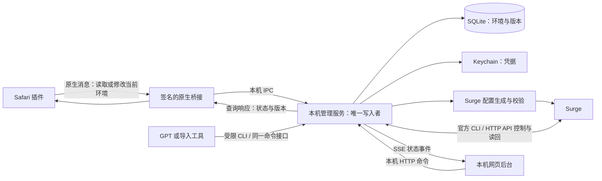

# 插件、网页后台与 Surge 的实时同步设计

2026-10-21，Asia/Taipei。状态：详细设计，未实现/未部署。补充并细化《方案1-场景驱动Safari代理设计》。

固定工作配置、统一命名、定向资源更新与生效门槛详见 [固定工作配置设计](固定工作配置-命名与更新机制.md)。本稿已据此修订：新增节点不再默认重载主配置，日常不得切换配置文件。

本稿直接回答：用户在插件中改了代理 IP，哪些组件收到什么消息，谁改 Surge，怎样知道改对了，以及网页如何同时显示结果。

## 1. 选定架构：网页是界面，本机服务是唯一控制中心

用户看到类似 Sub-Store 的本机网页后台，不需要单独操作一个复杂原生窗口。网页可以由 Safari 或 Chrome 打开，关闭网页不影响后台工作。

安装包仍需有一个最小 macOS 宿主和后台服务：纯网页无法可靠地访问 Keychain、写受限的 Surge 配置、获取 Safari 原生场景身份。网页界面替代原生管理界面，不等于取消本机执行组件。



核心原则：不是三个系统互相复制数据。**本机数据库保存用户想要的配置，Surge 是执行结果；插件和网页是同一后台的两种操作界面。**

代理凭据不通过 Amazon 页面、URL 参数或日志传播；插件不持有 Surge 管理密钥。网页在 127.0.0.1 上提供服务，拒绝局域网访问、非法 Host/Origin 和未认证写请求；同源会话加 CSRF 校验，不配置任意来源 CORS。前端只保存界面缓存，不作为配置真相来源。

## 2. 每条通信链路明确分工

| 链路 | 承载内容 | 工作方式 |
|---|---|---|
| 插件 → 原生桥 → 后台 | 当前场景身份、查询、保存、激活、检测请求 | Native messaging 请求/响应；后台按原生身份确认绑定 |
| 网页 → 后台 | 环境列表、导入、编辑、启动、停止托管 | 自己定义的本机 HTTP API；不是 Surge API |
| 后台 → 网页 | 保存、同步、检测、失败等状态变化 | SSE 事件流；断线后按事件序号补读，再核对完整快照 |
| 插件弹窗 → 后台 | 同步进度与当前状态 | 保存后按 operation_id 查询；弹窗打开期间约 1 秒增量查询，关闭停止；再次打开立即读取完整状态 |
| 后台 → Surge 文件 | 新增/修改/移除本应用管理的节点和规则 | 写临时版本、官方 CLI 校验、原子替换受管理文件 |
| 后台 → Surge API/CLI | 定向资源刷新、选择组成员、查询策略/规则/连接；主配置重载仅用于受控维护 | 串行调用，成功后读回；不将响应 success 直接等同网络通过 |
| Surge → 后台 | 当前有效状态 | 每次变更后主动查询；活动期间周期对账；事件接口可作提示，不作为唯一依据 |

Safari 原生消息暂按可靠的请求/响应设计，不假定存在长期连接或宿主随时向休眠扩展推送的能力。网页用 SSE 不代表 Safari 扩展也能用同样的常驻通道。低延迟通知可在实测后优化，正确性不依赖通知永不丢失。

“实时”定义为保存后立即启动同步并实时显示进度，不是等订阅定时刷新；网络检测耗时以真实完成为准，不承诺零延迟。后台即使网页和弹窗都关闭也继续执行已受理任务。

## 3. 绑定不是靠 IP 匹配场景

关联链：

```text
原生 Safari profile ID
        → environment_id
        → desired_proxy_revision / deployed_proxy_revision
        → Surge 实际节点名

当前激活环境 active_environment_id
        → SFE-ROUTE 组当前选择

固定 Safari 进程匹配入口
        → SFE-ROUTE
```

IP、名称和代理密码都是可修改属性，不能充当环境主键。修改 IP 不改变场景 ID、environment_id、买家号关联或 Cookie。

插件原生消息由宿主从 SFExtensionProfileKey 等已核验来源取得场景标识；客户端提交的 environment_id 只能作为辅助检查，不能未经比对就写另一场景。网页后台有全局编辑权限，通过明确的环境记录操作。

正式 native profile ID 的重启/重装稳定性仍需原生打包验证。身份缺失、扩展重装或跨设备迁移时重新关联，不能按同名自动猜测。网页本身不读取 Safari 私有数据库来获得身份。

## 4. 具体例子：在插件中把环境 A 的代理 IP 改掉

假设环境 A 的代理版本为 17，用户将代理连接地址修改为示例地址 203.0.113.20。环境 ID 不变，买家号信息不变。

1. 插件提交一个保存命令，包含“修改了哪些字段”、期望旧版本 17 和唯一 request_id。代理密码未修改就不发送；不能用空密码默认覆盖旧密码。
2. 原生桥补上可信的场景身份。后台检查该场景确实绑定环境 A、版本仍是 17、前置节点存在、字段能合法生成 Surge 配置。
3. 后台在同一个数据库事务中保存期望版本 18，并创建同步任务 op-xxx。密码变更写入新的 Keychain 引用，写失败不提交可用状态。响应“已保存，正在同步”，返回 operation_id。
4. 唯一同步执行器取任务，读取当前 Surge 配置及摘要，生成版本 18 候选配置。使用临时新节点名 SFE-N-E0001-US01-v018；旧 v017 节点暂时保留。
5. 对候选配置执行官方 CLI --check。失败则记录具体字段/校验错误，不切换当前出口。
6. 验证配置基线没有在生成期间被用户或订阅更新；仅当定向更新能力和连接影响测试通过时，原子发布节点资源，按枚举到的资源 key 更新，再读回组成员、错误及原选择。未通过则停在“已保存，待部署”，不自动重载主配置。
7. 用已验证可独立指定的候选节点做代理链预检：确认前置代理及 SOCKS5 可用，并记录该节点的出口。若本机版本不能独立检测外部节点，不借切换当前活动组来预检非当前环境，改为“已部署，待激活时验证”。预检结果不是“Safari 当前出口”。
8. 如果 A 不是当前激活环境：预检成功才显示“已部署、可供下次启动”；否则保留待验证状态。不选择 A，也不终止当前环境的连接。
9. 如果 A 正在使用：进入本稿第 7 节的受控切换，切换到 r18，处理旧连接，并由当前 Safari 场景检测实际出口。
10. 只有完成必要读回与检测才记录已应用版本 18。网页和插件收到同一操作的完成状态与实测时间。旧节点在不再被选择/引用且没有相关连接后延后合批清理，避免刚发布成功又立即触发第二次更新。

采用带版本的新节点是为了避免“原名节点参数变了，但旧连接仍在使用旧参数”而界面误报已切换；也便于快速回滚。用户仍然只看到一个环境和一份当前配置，不需要理解节点版本名。

## 5. 这些接口是谁的

下面是计划实现的**本机管理服务接口**，不是现有 Surge 接口：

| 接口/命令 | 用途 | 返回 |
|---|---|---|
| GET /api/environments | 网页环境列表 | 脱敏环境及各阶段状态 |
| native: getCurrentEnvironment | 插件读取当前场景绑定 | 绑定记录、当前网络环境、最近检测 |
| PATCH /api/environments/{id} / native: updateCurrentEnvironment | 保存字段变更 | 202 + operation_id + revision |
| POST /api/imports | 导入文件或结构化记录 | 批次 ID、逐项操作 ID |
| POST /api/environments/{id}/activate | 显式激活环境 | 操作 ID，不代表切换完成 |
| POST /api/routing/normal | 进入原 Surge 规则模式 | 操作 ID |
| POST /api/environments/{id}/probe | 重新检测 | 操作 ID、检测类型 |
| GET /api/operations/{id} | 读取操作进度 | 阶段、错误、当前有效版本 |
| GET /api/events | 网页 SSE | 不含秘密的有序状态事件 |

请求示意不包含真实凭据：

```json
{
  "request_id": "一次保存的唯一标识",
  "expected_revision": 17,
  "changes": {
    "proxy": {"host": "203.0.113.20", "port": 1080},
    "front_proxy_id": "front-01"
  }
}
```

SSE 事件示意：

```json
{
  "sequence": 842,
  "operation_id": "op-xxx",
  "environment_id": "env-A",
  "desired_revision": 18,
  "deployed_revision": 18,
  "active_revision": 17,
  "phase": "waiting_for_route_switch"
}
```

`202` 的含义是已受理并保存，不是完成。后台为同一 request_id 返回同一操作，浏览器超时后重复提交不会创建重复节点或反复切换。

Surge 实际使用的能力：

- 官方 CLI `--check <配置路径>`：检查候选配置。
- 本机 CLI `external-resource list/update <key>`：枚举及定向更新；本地资源重新加载行为仍需实测。
- `POST /v1/profiles/reload`：仅在受控维护中重载同一工作配置，不能假定不影响连接。
- `GET /v1/profiles/current`、`GET /v1/rules`：检查有效配置/规则。
- `GET /v1/policies`、`GET /v1/policies/detail`：核对节点。
- `POST /v1/policy_groups/select` 与对应 GET：选择、核对 SFE-ROUTE。
- `GET /v1/requests/active`、`POST /v1/requests/kill`：针对确认属于 Safari 的连接处理。
- 本机 CLI 可替代等价 HTTP 操作，优先复用已有可用控制方式；如开启 HTTP API，限回环监听，密钥只由后台保管。

上述官方接口中没有通用的“PATCH 某节点 IP/密码”。所以新增/修改节点走资源生成与明确的发布确认；优先定向刷新，不能默认重载。已经存在的环境之间切换只调用组选择与经验证的运行时入口操作，不重写节点。[Surge HTTP API](https://manual.nssurge.com/tools/http-api.html)

## 6. 配置怎样生成，为什么不只是订阅刷新

第一版固定使用从本机原配置复制出的日常工作配置，例如 `日常-Safari环境`，保持名称、路径和配置身份不变。初始化的一次启用另行安排；日常、普通模式和不同环境均不调用 switch-profile。

- 原始备份只用于恢复；之后以当前工作配置为基线，保留用户后续修改，不每次从初始备份覆盖。
- 一次创建固定组 SFE-ROUTE。新增环境增加节点，不默认增加组；统一命名见固定工作配置设计。
- 优先将环境出口节点放进 policy-path 独立资源，通过本机实际存在的 CLI 定向刷新。主配置保存原有内容和固定结构，不随环境切换重写。
- 本地资源即时重新读取、外部成员选择、前置引用与无其他应用中断尚未实测；这是发布门槛，未通过则保存为待部署，不用主配置 reload 偷偷替代。
- 新增前置节点/组等结构变更属于低频维护。批量校验和合并，只有在允许的维护窗口按已验证的方式更新同一工作配置。
- 修改买家号/密码或显示名不触碰 Surge。普通/托管、阻断/检测状态优先采用经实测的精确运行时入口管理，不能每次状态变化都重载主配置。
- 活动文件写入前已完成全部检查，并核对 Surge 自动重载行为；原子替换只解决文件完整性，不证明网络无中断。含凭据文件限制权限，日志脱敏。

Sub-Store 式的订阅/导出不能单独完成实时控制：发布文件不等于 Surge 读取了新内容，组成员更新不等于已选中，更不等于旧连接已迁移。禁止顺便更新全部外部资源。

官方支持 policy-path，但当前 Surge 6.5.0 的定向更新效果须验证；最新 HTTP API 标注的 6.10+ 资源下载和 6.11+ 外部节点查询不能当作本机已有能力。详见 [发布机制与证据](固定工作配置-命名与更新机制.md)。[外部节点说明](https://manual.nssurge.com/policy-groups/policy-including.html)

模块也不能充当节点存储：普通 [Proxy]/[Proxy Group] 不允许由模块调整，模块普通规则仅支持内置策略。[Surge 模块限制](https://manual.nssurge.com/profile/module.html)

## 7. 正在使用的环境：切换与实测的具体状态

控制网络的过程不能与数据库事务假装成一个原子操作。采用有阶段、有回滚记录的事务，并且所有 Surge 写入只由一个执行器处理。

建议状态：

```text
SAVED → VALIDATING → DEPLOYING → PREFLIGHT_OK
    非当前环境 → READY_FOR_NEXT_OPEN
    当前环境 → SAFARI_BLOCKED → VERIFY_ONLY → ACTIVE_VERIFIED
    任一步失败 → FAILED / ROLLING_BACK / BLOCKED_NEEDS_ATTENTION
```

以下是待实现的四种逻辑模式。必须先证明运行时规则操作可用且不会导致全局重载；当前只确认临时规则读取可用，未验证写入。不能将这个设计表当作已有能力。

网络入口提供四种明确模式：

| 模式 | Safari 规则行为 | Chrome |
|---|---|---|
| NORMAL | 没有本应用的重定向入口，继续原规则 | 原规则 |
| BLOCKED | 精确匹配 Safari 的入口拒绝新请求 | 原规则 |
| VERIFY_ONLY | 仅允许指定出口检测服务经 SFE-ROUTE；其余 Safari 请求拒绝 | 原规则 |
| ACTIVE | 精确匹配 Safari 请求，交给 SFE-ROUTE | 原规则 |

VERIFY_ONLY 的规则顺序概念如下，实际语法必须在当前 Surge 上校验并实测：

```text
Safari 完整进程路径 AND 指定检测域名 → SFE-ROUTE
Safari 完整进程路径 → REJECT
用户原规则……
```

这解决“浏览器还被总闸阻断，怎样检测其真实出口”的矛盾。不能让代理预检成功冒充浏览器检测成功。验证期间允许范围只覆盖检测所需目标；DNS、连接复用、检测端点共享地址、其他规则/模块优先级均要纳入测试。

具体切换顺序：

1. 记录切换前有效配置、选中成员和环境版本；先确认新节点预检成功。
2. 设置 BLOCKED 并读回；暂停该环境自动打开订单和填充功能。
3. 仅结束确认属于 Safari 的旧连接；每个连接处理结果可查询，不全局清连接。
4. 选择新节点并读回选择；设置 VERIFY_ONLY 并读回规则顺序。
5. 当前场景的验证页发送带一次性测试编号的出口请求，记录返回出口与检测时间。Surge 侧按检测域名、Safari 进程、独立新连接和时间窗口核对策略。不开 MITM 时 Surge 看不到 HTTPS 路径/query 中的编号，不能假称按该编号直接匹配；浏览器请求编号与连接元数据必须分别记录。
6. 成功后设置 ACTIVE、读回并确认有效版本；恢复正常使用。
7. 如需打开订单才打开，已有登录状态保留；仅跳到登录页面时调用填充。

重要影响：受控切换会主动结束 Safari 旧连接，Safari 会短暂无法发送业务请求；目标是其他应用持续联网，仍需独立验证。已有页面的后台请求可能失败。不能承诺“无感迁移已有连接”，也不能默认刷新可能有未提交内容的页面。保持页面和登录数据，必要时提供“重新加载订单页”，不替用户重放提交操作。

若受管理阻断/放行规则在当前 Surge 版本上无法可靠验证，不能发布“无错路切换”。回退到保存工作、关闭旧 Safari 会话再受控打开的方式，是否采用该方式需明确产品设置。

用户已经打开多个不同场景时，VERIFY_ONLY/ACTIVE 仍然作用于整个 Safari，不能消除单出口设计的场景冲突。后台只允许一个活动环境，旧环境关闭/后台停止的检查沿用主设计。

## 8. 失败与回滚不是“再试一次”

| 失败点 | 保持的真实状态 | 界面表现 |
|---|---|---|
| 表单或版本校验失败 | 未受理新版本 | 字段错误或冲突，原值保持 |
| 期望版本已保存，生成/校验失败 | 新版本待修复；旧版本仍有效 | 已保存但未同步，不显示新 IP 已使用 |
| Surge 无响应 | 保存任务，先查询实际状态，不能盲目重复重载/切换 | 同步状态未知，正在核对 |
| 候选节点预检失败 | 当前活动环境不切换；新版本失败 | 明确前置/出口测试失败 |
| 已进入阻断但新出口验证失败 | 尝试恢复旧节点并重新核验 | 回滚中；不能静默报成功 |
| 回滚成功 | 明确显示旧版本、旧实测出口和新修改失败 | 保留编辑内容供修复 |
| 回滚失败或状态不可判定 | 保持已确认的 Safari 阻断状态；否则明确无法确认 | 需要处理，不自动 DIRECT |
| Surge 关闭/接管关闭 | 控制器不具备系统级拦截保证 | 停止启动/填充并告知失去接管 |

不把所有失败都自动回退原规则：用户配置了特定账号代理，切换失败后直接恢复普通路由可能让账号请求走错出口。进入 NORMAL 应是明确操作，而不是失败兜底。

## 9. 多界面同时编辑、掉线和外部修改

三个不同的版本维度：

- `environment_revision`：单环境用户数据版本。
- `configuration_generation`：固定工作配置及节点资源的发布代数，不是不同活动配置文件；资源另记摘要。
- `route_epoch`：当前 Safari 活动环境切换序号。

网页和插件保存时携带 expected_revision。旧版本编辑返回冲突和脱敏差异，不能采用“最后写入覆盖”。如果网页显示 r17，插件已经保存 r18，网页再次提交 r17 会被拒绝并要求刷新/合并。

数据库保存期望值和任务必须同一事务提交；任务有 request_id 幂等约束。后台使用全局 Surge 写锁，即使修改不同环境也不能同时发布资源或重载配置。连续待处理修改可以合并生成一份配置，但每个操作保留自己的结果，已开始切换的事务不能被无记录覆盖。

事件包含 sequence 和版本号；客户端忽略旧事件。SSE 断线重连从 last sequence 补读，事件过期则读取完整快照；插件弹窗重开也读取后台完整状态，不用旧 UI 变量恢复“已连接”。

后台重启先读数据库未完成任务，再读取 Surge 实际状态和配置摘要，完成对账后再决定继续或回滚，不把所有任务重放一遍。已经过期的 Safari 验证结果不能提交到新 route_epoch。

用户直接在 Surge 改组选择或切配置时，后台检测差异，显示“外部修改，当前未验证”。不在后台反复争抢用户选择。重新接管需要走明确的激活/恢复命令。

原配置或订阅更新：检查基线摘要，仅重新生成本应用拥有的段；冲突时停同步并展示差异。配置重载可能造成瞬时影响，Chrome 的策略保持不变不等于已经证明完全无延迟影响，需要压测和真实连接验证。

## 10. 数据与状态如何在两个界面一致显示

后台状态快照包含：

```text
environment_id、场景绑定、展示名、站点、买家号摘要
期望代理版本、已部署代理版本、当前活动代理版本
期望连接地址、当前使用连接地址、前置引用
当前操作阶段、错误及可执行操作
代理预检结果、Safari 实测结果（分别存储）
实测时间、Surge 策略、有效配置版本、route_epoch
```

当用户把 .10 改为 .20，界面在同步期间可以显示：

```text
修改后地址：203.0.113.20:1080
当前使用：203.0.113.10:1080
状态：已保存，正在验证新代理
```

成功后再变为：

```text
当前使用：203.0.113.20:1080
实际出口：本次 Safari 检测结果
状态：已生效，xx 秒前验证
```

编辑用户名/密码字段只返回是否已配置；密码未改、明确替换、明确清除使用不同语义。后台事件和一般列表不包含明文密码。自动填充使用单独的受限命令，核验场景、当前网络状态和登录页来源之后才获取当前账号凭据，不通过通用状态接口返回。

## 11. 需要补充的实际验收

在已有网络实验之外，新增这些验收用例：

1. 插件改当前环境 IP → 网页即时显示待同步 → Surge 生效节点变化 → Safari 出口变化 → 两端一致显示已生效。
2. 网页改非当前环境 IP → 插件能读到新版本 → 当前环境出口不变。
3. 只改买家号/密码 → 不发生 Surge 重载和组切换；已经登录的页面不被强制登出。
4. 同时编辑冲突 → 旧 revision 被拒绝，无丢失覆盖。
5. 保存后关弹窗/网页 → 后台继续；重开显示真实结果。
6. 配置校验失败、前置失败、Surge 超时 → 不出现“已生效”假成功。
7. 在每个阶段强制停止后台后重启 → 根据事实恢复，不重复创建节点或回退到 DIRECT。
8. 旧 H2/长连接关闭，新请求使用新出口；Chrome 相同网站出口不变。
9. VERIFY_ONLY 时 Amazon 被阻止、检测服务可用；验证成功后再正常访问。
10. 普通模式执行完整原规则，恢复托管不丢失用户原有设置。
11. 当前 Surge 6.5.0 下全部 API/CLI 和规则模式逐项实测；不借用新版本才有的能力。
12. 定向刷新新增节点期间 Chrome 长连接与新请求连续，工作配置身份不变；单纯切环境不发生主配置重载；坏资源不丢失原选择。

本稿定义了待实现的接口、状态和事务，没有声称上述同步服务、网页后台或阻断机制已经存在。
